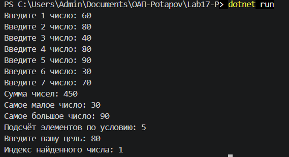

Автор: Потапов Даниил
Группа: ИСП-252

Алгоритмы обработки массивов.

Реализовано:
- сумма элементов;
- подсчёт элементов по условию;
- минимум и максимум;
- линейный поиск;
- поиск первого индекса.

1. Почему максимум нельзя всегда начинать с `0`?

Ответ: Потому что за начальное значение стоит брать первый элемент массива, иначе, если в массиве будут все числа отрицательные, то 0 будет больше и программа вернёт значение 0, хотя его даже нет в массиве.

2. Что означает `-1` после поиска индекса?

Ответ: Значение -1 означает, что искомый элемент не найден в массиве.

3. Чем сумма отличается от подсчёта элементов?

Ответ: Сумма складывается значения самих элементов, пока Подсчёт элементов лишь считает сколько раз встретились элементы по условию.

